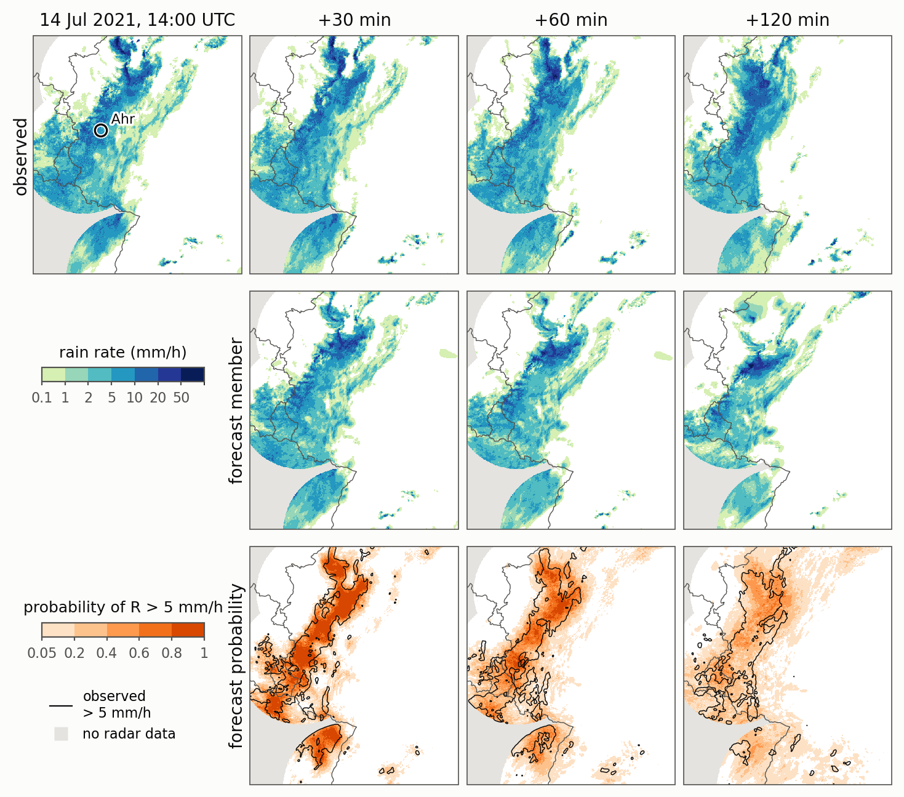
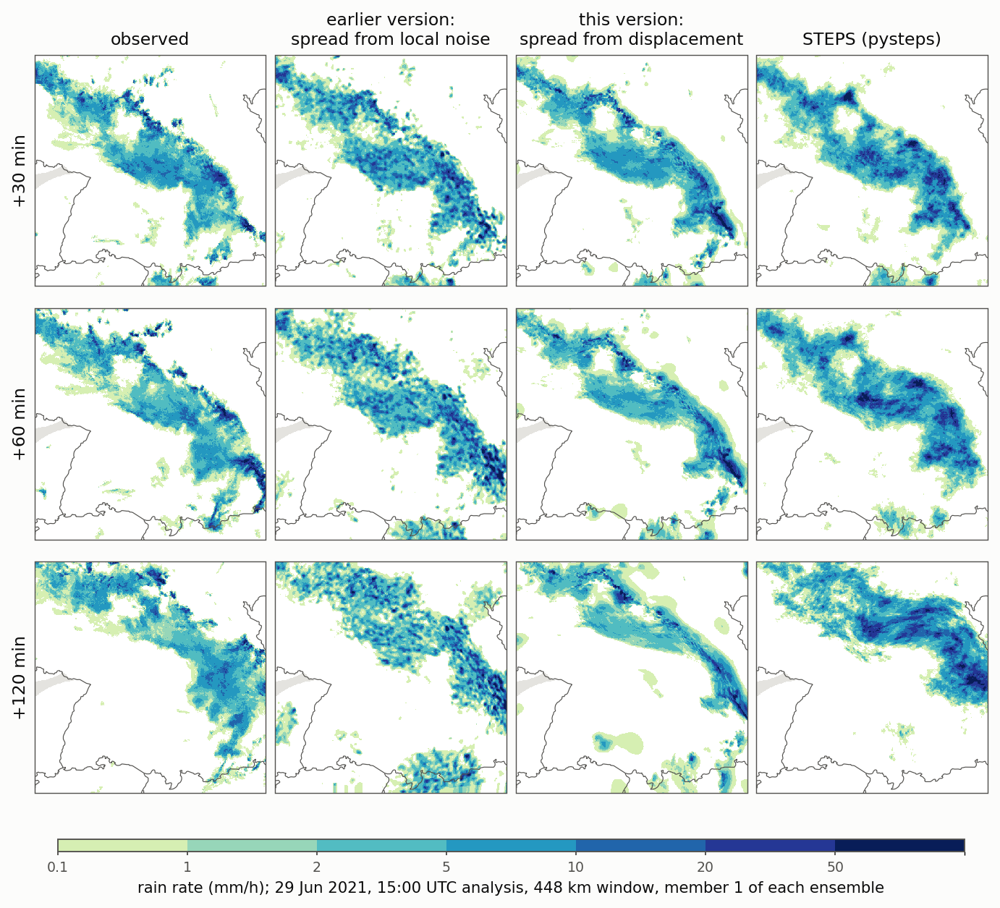
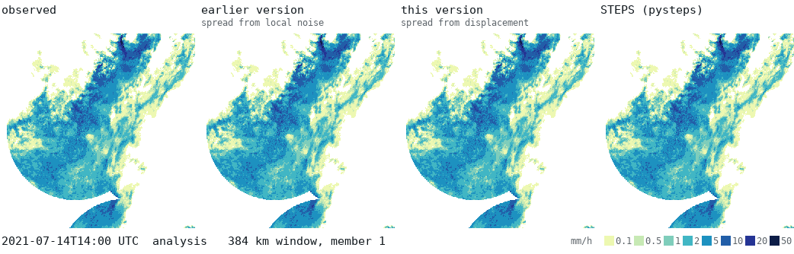

# Stochastic Lagrangian Precipitation Nowcasting

Probabilistic forecasting of high-resolution precipitation fields (+2 h horizon, 1 km spatial / 5 min temporal resolution over Germany) with a physics-informed modeling approach. Trained on 15 warm seasons (0.92M frames) of RADKLIM-YW radar composites from DWD (Deutscher Wetterdienst).

The model is a convolutional neural network (CNN), i.e. U-Net, that operates within a differentiable semi-Lagrangian advection scheme instead of predicting frames solely as a black box. A variational optical-flow velocity field is refined and Lagrangian growth as well as decay along trajectories are predicted. After training with the continuous ranked probability score (CRPS) at several spatial scales as a proper scoring rule, an ensemble is generated by the model.

Current State: 

- The 20-member ensemble outperforms a standard configuration of the Short-Term Ensemble Prediction System (STEPS), which is an established stochastic baseline in meteorology, in CRPS on validation data (4–5% at pixel scale from +30 min on; 7–17% at 16 km at all lead times; during the first 10 minutes STEPS remains better at pixel scale). 
- While development took many experimental runs, the present results are achieved by a 3-hour training run with limited local compute, i.e. my personal GPU (RTX 4070 Super 12 GB). A 20-member forecast of the full domain takes about 3 seconds on this GPU.
- By design, individual members are displaced/evolved radar fields that keep most of the observed texture.
- For a quick first impression on modeling progress, I recommend looking at the ensemble member figure, the animated GIF as well as the identified limitations and key findings below.

*Important*: The project pivoted to an experiment in doing research together with frontier AI models as collaborators where I assume a higher-level role thinking about the direction and physical framing. For details on my current approach, see my written notes in the section below: [How this project is made](#how-this-project-is-made). Note that the technical parts of the README below were drafted by Claude and reviewed/curated by me.



*Difficult validation case: Severe flood event on 14 July 2021 (448 × 512 km subdomain; from validation set). **Top:** Observed rain rate. **Middle:** Single ensemble member (uncurated). **Bottom:** Ensemble probability P(R > 5 mm/h) with observed contours. Naturally widening uncertainty with lead time. Remaining artifacts: smooth patches of light rain where new rain forms on dry pixels (e.g. top of +120 min panel), and the edge of the radar gap in the south, which is advected with the rain (see limitations 1 and 3 below). Note: Case fixed before inspecting any forecast. It is one of the cases where the model compares worst with STEPS, which has the better CRPS here.*

---

## Physical Formulation & Architecture

In log-rain space $y = \log(1 + R / 1\text{ mm h}^{-1})$, rain that moves with a 2D motion field $\mathbf{u}$ follows the transport equation $\text{D}y/\text{D}t = s$: advection plus a net source/sink $s$. The forecast at lead time $k$ is written explicitly in Lagrangian coordinates:

$$y_k(\mathbf{x}) = y_0(\mathbf{X}_k(\mathbf{x})) + S_k(\mathbf{X}_k(\mathbf{x}))$$

$\mathbf{X}_k(\mathbf{x})$ is the departure point (where the rain arriving at $\mathbf{x}$ after $k$ steps was at the analysis time) and $S_k$ the growth or decay it has undergone on the way.

* **Motion ($\mathbf{u} = \mathbf{u}_0 + \Delta\mathbf{u}$):** Departure points are integrated backward in time on a 16 km grid. A variational optical flow (brightness constancy plus Horn–Schunck smoothness, fitted to the preceding 30 minutes of every sample) provides $\mathbf{u}_0$, so the network does not have to learn large displacements from scratch. It predicts a bounded correction $\Delta\mathbf{u}$.
* **Nearly rigid motion with short-lived detail:** The motion is kept nearly rigid locally (strong smoothness prior on $\mathbf{u}_0$, shear penalty on the 2 h trajectory map), so that growth and decay are represented by the source term and not by convergence of the motion field ([finding 5](#key-diagnostic-findings)). The local deformation that a less smooth optical flow sees is real but short-lived: it acts on the trajectories with a weight that fades to zero at +60 min ([finding 8](#key-diagnostic-findings)).
* **Growth and decay ($S_k$):** Predicted on a 4 km grid in analysis-time coordinates ($t=0$), where the radar observations are directly visible to the encoder, then transported along $\mathbf{X}_k$.
* **Ensemble:** The main source of spread is position uncertainty. Each member advects the observed field with its own smooth random velocity perturbation (correlation length ~500 km), whose amplitude the network predicts from the situation. A spatially correlated noise field (32 km) additionally modulates every decoder block via FiLM layers, so that growth and decay differ between members. One forward pass with an independent noise draw yields one member.
* **Loss:** Almost-fair CRPS at 1, 4, 16 and 64 km spatial pooling scales (the coarser scales penalize spatially incoherent noise), regularized by a consistency term that ties the trajectories to the observed past frames.
* **Physical starting point:** With zero-initialized output layers, the untrained model is exactly classical optical-flow extrapolation; with the member perturbations, it is a displacement ensemble of the latest observation.

Full mathematical and implementation details: **[docs/method.md](docs/method.md)**.

---

## Validation Benchmark (2021–2022 Seasons)

All methods forecast the full 1024 × 832 km domain for the same 120 analysis times with rain and are scored on identical valid-coverage masks.

* **CRPS (Continuous Ranked Probability Score)** generalizes the mean absolute error to probabilistic forecasts (lower is better). It is evaluated in $\log(1+R)$ at pixel scale (1 km) and regional scale (16 km).
* **Brier Skill Score** measures the skill of the forecast probability of $R > 5\text{ mm/h}$ relative to sample climatology (higher is better; 0 = climatology).

| Method | CRPS (1 km)<br>+30 / +60 / +120 min | CRPS (16 km)<br>+30 / +60 / +120 min | Brier Skill, P(R > 5 mm/h)<br>+60 min |
| :--- | :---: | :---: | :---: |
| Eulerian Persistence | 0.106 / 0.127 / 0.146 | 0.099 / 0.132 / 0.160 | −0.77 |
| Lucas–Kanade extrapolation (pysteps) | 0.074 / 0.096 / 0.117 | 0.060 / 0.090 / 0.122 | −0.47 |
| STEPS, 20-member ensemble (pysteps) | 0.047 / 0.060 / 0.069 | 0.044 / 0.063 / 0.077 | 0.06 |
| Displacement ensemble, no training (20 members) | 0.048 / 0.060 / 0.069 | 0.043 / 0.061 / 0.077 | 0.12 |
| **This Model (20-member ensemble)** | **0.045 / 0.056 / 0.066** | **0.038 / 0.055 / 0.071** | **0.14** |

*Paired differences vs. STEPS at +30 / +60 / +120 min (95% intervals from a block bootstrap over calendar days): −0.0021 [−0.0027, −0.0016] / −0.0031 [−0.0038, −0.0024] / −0.0025 [−0.0036, −0.0016] at 1 km and −0.0064 / −0.0071 / −0.0056 at 16 km. All intervals exclude zero. Two training seeds of a sibling configuration differ by at most 0.0004 in these scores.*

* **Short lead times:** At pixel scale STEPS is better during the first 10 minutes (by 6% at +5 min, 3% at +10 min). The model is ahead from +20 min on, and at 16 km at all lead times.
* **What training adds:** The displacement ensemble in the table needs no training: every member moves the latest radar image with the optical flow plus its own smooth random velocity perturbation. It already matches STEPS at pixel scale. The trained model improves on it by 4–7% at 1 km and 7–12% at 16 km (paired intervals exclude zero).
* **What the network learned:** An ablation at inference on 40 of the cases locates this gain in the growth and decay term ([finding 8](#key-diagnostic-findings)). Without the term, the trained model is no better than the untrained one. Replacing it by its average for the local rain intensity, a correction that ignores the situation, does not help either. The predicted growth and decay explain 22–30% of the variance of the observed Lagrangian change of 16 km area means (correlation 0.5).
* **Heavy rain:** Above 10 mm/h, training adds nothing. The advantage over STEPS there (fractions skill score at 21 km for $R > 10\text{ mm/h}$ at +30 / +60 min: 0.57 / 0.31 against 0.46 / 0.21) comes from displacing observed structure.
* **Uncertainty calibration:** The ensemble spread-to-RMSE ratio is 0.78 at +5 min and 0.91–0.93 from +30 min on (STEPS: 0.64 rising to 0.87). The rank histogram is flat within 12% at +60 min (with STEPS, the observation exceeds all members 1.8× as often as it should).
* **Spatial structure:** Members are about as isotropic as the observations (coherence of the gradient structure tensor at +30 / +60 / +120 min: 0.32 / 0.33 / 0.36, observed 0.33; earlier versions reached 0.52, see [finding 5](#key-diagnostic-findings)). At +60 min, members carry 53% of the observed power at 2–5 km wavelengths, 81–89% at 5–20 km and 83% at 20–50 km (STEPS: 32%, 39–45%, 62%; the previous version: 29%, 90–134%, 76%). The missing power at the smallest scales has two causes: the bilinear interpolation at the departure points (bicubic interpolation raises the 2–5 km power from 53% to 81% at equal CRPS and is adopted for the next run) and the smooth new rain (limitation 1).

### The ensemble members



*29 June 2021, 15:00 UTC (convective validation case; the first member drawn of each ensemble, not selected). The two model versions have nearly the same CRPS (within 0.0004 at 16 km; this version is better by 0.0006–0.0013 at 1 km up to +60 min). In the previous version, the spread was generated by noise fields inside the network and appeared as local amplitude noise: a mottled texture that no radar would observe. In this version, each member moves the observed field with its own smooth velocity perturbation, so the members inherit the observed structure, and the network adds growth and decay ([finding 7](#key-diagnostic-findings)). The +120 min panel shows the remaining defects of this version: smooth patches of new light rain (limitation 1) and a rain band that is narrower and more drawn out than the observed one.*

<p align="center"></p>

*The flood case above as an animation from the analysis time to +120 min (384 km window, first member of each ensemble). Rain structures in the member of this version persist and move like the observed ones; the edge of the radar gap in the south travels with them (limitation 3).*

### Current limitations and active work

1. **New rain is a smooth field.** Where the model forecasts rain on pixels that are dry at the analysis time, a member contains smooth patches of light rain (halos and bubbles around the rain areas, visible at +120 min in the figures above) instead of cells. This new rain carries real skill (removing it worsens the CRPS by 0.0008–0.0024), but it is spread out evenly as a hedge. A mean-preserving cascade that concentrates it into member-specific cells has been built and awaits training.
2. **Probabilities and rain areas are not fully calibrated.** High probabilities are overconfident ($P = 0.8$ for $R > 5\text{ mm/h}$ verifies at 0.63 at +60 min; STEPS: 0.48), the ensemble is underdispersive at the shortest leads (where STEPS is still better at pixel scale), and the area of moderate rain is too small (frequency bias 0.80 at +60 min for $>5\text{ mm/h}$; 1.05 for $>1\text{ mm/h}$, 1.00 for $>10\text{ mm/h}$). The almost-fair CRPS used for training ($\alpha = 0.95$, two members) lowers small probabilities by construction.
3. **Missing radar data enter as zeros.** The edges of coverage gaps are advected like rain boundaries, and rain flowing in across the domain boundary is not represented.
4. **The advantage over STEPS is not uniform.** The model is better in 87% of the cases at +60 min and 74% at +120 min (1 km), and loses by up to 24% on a few cases with large, persistent rain areas, among them the flood case shown above.
5. **Radar alone cannot see convective initiation.** Clouds grow for 15–45 min before the first echo, so every radar-only nowcaster, STEPS included, misses most new storms. Terrain, atmospheric environment (reanalysis) and satellite data are the planned next inputs.
6. **One training run, one baseline configuration.** Results reflect a single training run of 3 hours (31k steps, 124k samples; validation skill was still rising) against one standard `pysteps` STEPS configuration (library defaults), on retrospectively gauge-adjusted RADKLIM data. On 12 of the cases, the optional noise adjustment `noise_stddev_adj="auto"` calibrated the spread of STEPS and changed its CRPS by −4% to +6% depending on scale and lead time (better up to +30 min, worse at +2 h). Longer training, a comparison with learned nowcasting models (e.g. DGMR, NowcastNet, LDCast) and the final evaluation on the locked 2023–2024 test seasons are pending.

---

## Key Diagnostic Findings

Every major architectural choice emerged from targeted diagnostic studies rather than hyperparameter sweeps:

1. **The network did not learn large-displacement transport by itself.** With the velocity predicted by the U-Net from stacked frames alone, advection was no better than zero velocity: bilinear grid sampling only supplies local spatial gradients, a weak signal for displacements of tens of kilometers. Supplying a variational optical flow as first guess solved this (on par with Lucas–Kanade in `pysteps` in skill).
2. **Where the noise enters decides whether members differ.** Noise concatenated as extra input channels was ignored by the network, which collapsed toward a smooth conditional median (spread/error of 0.77 at +2 h). Noise that modulates every decoder block via FiLM layers (inspired by ECMWF's AIFS-CRPS) restored the spread and the skill gain over STEPS. Finding 7 later moved the main source of spread from this noise to displacement.
3. **An oracle motion field overstates what better motion could give.** A stationary velocity field fitted to the *future* frames reduces the 2 h advection error by ~40% compared to any velocity estimated from past frames ([motion_study.py](scripts/motion_study.py)). Part of that gain is not motion, though: such a fit also expresses growth and decay as divergence and convergence (finding 5).
4. **Physics losses require boundary-shortcut tests.** An early motion-consistency loss evaluated only over valid in-crop trajectories was trivially driven to zero by pushing all trajectories outside the domain boundary. This is now prevented and covered by an automated regression test.
5. **A motion field that fits the past well can still be wrong for extrapolation.**
   * *Symptom:* Zoomed in, forecast members showed filaments along the flow, while observed rain stays cellular.
   * *Cause:* Not the learned growth/decay term (it is isotropic in analysis-time coordinates) but the trajectory map itself. A weakly regularized optical flow explains growth and decay as convergence and divergence, and a stationary field with strain rate $e$ stretches material lines like $\exp(e\,t)$, the stirring of a passive scalar. After 2 h the median stretch anisotropy of the map in rain was 2.4, with 1% of pixels folded.
   * *Why it went unnoticed:* For pure extrapolation this strain is even useful (a shrinking rain area keeps shrinking; nearly rigid fields have a 5–9% larger advection error), so tuning the motion field on advection skill led to it. Neither the radially averaged power spectrum nor the CRPS revealed the artifact, and the deformation even supplied part of the members' small-scale variance.
   * *Fix:* Inside the model, growth and decay belong to the source term. With a nearly rigid motion field (map anisotropy 1.1) the streaks are gone (structure-tensor coherence at +2 h: 0.52 → 0.31, observed 0.33), at a cost of about 1% in pixel-scale CRPS up to +60 min, which finding 8 recovers. A deformation diagnostic, a direction-sensitive verification score and regression tests now cover it ([advection.py](nowcast/advection.py), [verify.py](nowcast/verify.py)).
6. **Compute went to the wrong place.** The optical-flow fit consists of many tiny operations and took 60% of a training step on the GPU. As a fixed function of the inputs it belongs to the data pipeline: computed by the data-loader workers on the CPU, a step takes 0.30 s instead of 1.2 s. Four times as many optimizer steps in the same 3 hours improved the CRPS by 2–6%, several times the difference between two training seeds. The character of the members did not change with more training: the formulation, not compute, limited their realism (finding 7).
7. **Good scores do not make plausible members.**
   * *Problem:* The CRPS scores each pixel's distribution and that of area means, but not the arrangement of rain within a single member. With noise fields that act locally, the network expressed its uncertainty as local amplitude noise and erased the fine structure of the analysis, at excellent scores ([figure](#the-ensemble-members)).
   * *Fix:* A training-free test pointed to it within minutes: an ensemble that only displaces the latest observation with smooth random velocity perturbations had nearly the CRPS of STEPS, with members that are radar fields by construction. Making displacement the primary source of spread kept the advantage over STEPS.
   * *Open:* Two of three configurations trained this way diverged. The cause: with negative log-rain values clipped only after interpolation, the gradient with respect to the departure points was 40 times larger than with clipping before it (same weights and batches). The training run with the reordered clipping is pending.
8. **The network learned growth and decay, not motion; the motion detail came from physics.**
   * *Ablation:* Taking the trained model apart at inference (40 cases, identical member displacements) showed that its learned velocity correction contributes nothing by itself, that a growth/decay term which ignores the situation does not help, and that the situation-dependent term carries the gain. The short-lead motion error left by the nearly rigid flow (finding 5) was therefore still there.
   * *Fix:* The deformation seen by a less smooth optical flow is real but does not persist, so it now has a lifetime instead of being discarded: it acts on the trajectories with a weight that fades linearly to zero at +60 min, and the displacement it has produced stays.
   * *Effect:* Without retraining, the pixel-scale CRPS fell by 7% at +5 min, 3% at +30 min and 2% at +60 min on all 120 cases (better in 82–95% of them), and the streaks did not return (coherence at +2 h: 0.36, observed 0.33; 0.40 with the detailed flow at all leads).

---

## v1 Refactor

The first standalone version of this project ([v1](https://github.com/jntnlx/radolan-nowcasting/tree/c9435782770e991039a0265c7d8b2384a75c1615)) based on multiple prototypes implemented a deterministic U-Net forecasting +30 min ahead on 128 × 128 km patches, trained on six seasons with an intensity-weighted mixed pixelwise loss and benchmarked against persistence and optical-flow advection. While v1 beat persistence, it showed the textbook limitation of deterministic pixelwise training: forecasts blurred into a smooth conditional mean, reducing heavy precipitation areas ($>10\text{ mm/h}$) to 0.27× observed coverage at +30 min (persistence: 1.1×).

**v2** retains the RADKLIM data source and optical-flow reference while rebuilding the system from first principles: full-domain (1024 × 832 km) lossless data streaming with explicit radar coverage masks instead of discarded samples, a 2 h horizon, semi-Lagrangian advection as an explicit physical operator, and an ensemble trained with a proper scoring rule. Whereas v1 used 2023–2024 for validation/testing, all v2 design decisions are made strictly on 2021–2022.

## Reproduce

```bash
conda env create -f environment.yml && conda activate radar-ml

python scripts/build_store.py  # download + build store

python -m pytest tests  # scientific contracts
python -m nowcast.train --run my_run --hours 3 --lr 2e-4 --compile --workers 6 \
    --motion-noise 1.5 --film-levels 5 --source-level 2  # the configuration shown here
python -m nowcast.train --run my_run --resume  # continue after interruption
python -m nowcast.evaluate --method steps --cases 120  # classical baseline (CPU)
python -m nowcast.evaluate --method runs/my_run/best.pt --cases 120 --motion-detail 60  # inference

python scripts/report.py runs/eval/val_120
python scripts/readme_figure.py --checkpoint runs/my_run/best.pt --motion-detail 60
python scripts/member_panel.py --checkpoint runs/my_run/best.pt --motion-detail 60  # members next to STEPS
```

## Modules

| module | content |
|---|---|
| [config.py](nowcast/config.py) | domain, time axis, splits |
| [radklim.py](nowcast/radklim.py), [store.py](nowcast/store.py) | DWD archive decoding with strict unit checks; lossless zarr frame store |
| [transforms.py](nowcast/transforms.py) | rain rate ↔ model space |
| [advection.py](nowcast/advection.py) | differentiable semi-Lagrangian advection, variational optical flow |
| [model.py](nowcast/model.py) | stochastic Lagrangian network |
| [losses.py](nowcast/losses.py) | CRPS family, motion consistency, smoothness |
| [data.py](nowcast/data.py), [train.py](nowcast/train.py) | sampling of training windows; resumable training loop |
| [baselines.py](nowcast/baselines.py) | persistence, extrapolation, STEPS (pysteps) |
| [verify.py](nowcast/verify.py), [evaluate.py](nowcast/evaluate.py) | verification scores; resumable full-domain evaluation |
| [scripts/](scripts/) | store build, report, figures, motion and case studies |

## Data and References

Radar data: 

Deutscher Wetterdienst, RADKLIM Version 2017.002, reprocessed
quasi gauge-adjusted radar data, 5-minute precipitation sums (YW). DOI: [10.5676/DWD/RADKLIM_YW_V2017.002](https://doi.org/10.5676/DWD/RADKLIM_YW_V2017.002). From the [DWD Open Data](https://opendata.dwd.de) server.

Relevant reference literature:

* Bowler, Pierce, Seed (2006): STEPS, a probabilistic precipitation forecasting
  scheme. *Q. J. R. Meteorol. Soc.* 132.
* Pulkkinen et al. (2019): Pysteps, an open-source Python library for
  probabilistic precipitation nowcasting. *Geosci. Model Dev.* 12.
* Ferro (2014): Fair scores for ensemble forecasts. *Q. J. R. Meteorol. Soc.* 140.
* Lang et al. (2024): AIFS-CRPS, ensemble forecasting using a model trained with
  a loss function based on the CRPS. arXiv:2412.15832.

Learned nowcasting models, not yet compared (limitation 6):

* Ravuri et al. (2021): Skilful precipitation nowcasting using deep generative
  models of radar (DGMR). *Nature* 597.
* Zhang et al. (2023): Skilful nowcasting of extreme precipitation with
  NowcastNet. *Nature* 619.
* Leinonen et al. (2023): Latent diffusion models for generative precipitation
  nowcasting with accurate uncertainty quantification (LDCast). arXiv:2304.12891.

---

## How this project is made

This project has evolved from manually building scientific-programming ML prototypes into an exploration of employing state-of-the-art AI models as research collaborators.

After initially refactoring my earlier work into a single deterministic baseline ([v1](#v1-refactor)) with the help of GPT-Astra, it quickly became clear that emerging frontier models, largely beginning with Claude Opus 5.5, were starting to enable a significantly more ambitious general scope and very fast research iteration. To embrace this, a subsequent v2 refactor elevated the project from deterministic U-Nets based on patches to a differentiable Lagrangian ensemble ansatz covering the full domain, which corresponds to the first fruitful result of this collaborative approach.
 
As part of the current approach, I take a higher-level architectural role working together with models in selected agentic harnesses. The models perform most of the implementation, set up and run the experiments, subsequently analyze the results and diagnose findings, as well as iteratively suggest and discuss the next steps with me. My role has shifted to brainstorming and proposing ideas based on the literature and our findings, reviewing each iteration, judging experiment outcomes and forecast quality, as well as thinking about the physical framing and general direction of the project.

While the share of technical work that the models can currently do is impressive and gets increasingly larger, I still have to monitor their work closely to catch them going off in directions that were not intended. Model research taste and intuition are getting better but are still somewhat lacking, which I try to supplement where I can. This makes the collaboration very productive as I can focus on generating ideas that are immediately testable with experiments. Results are always compared against established baselines and physical as well as statistical contracts are enforced by unit tests.

I take full responsibility for the scientific and technical content of this repository.